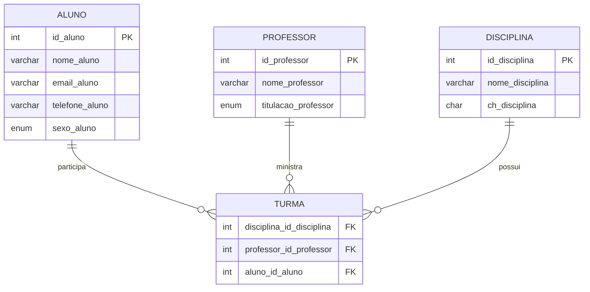

# Banco de Dados Acadêmico

<p align="center">
  
  
  
</p>

<p align="center">
  <strong>Projeto acadêmico para gestão de alunos, professores, disciplinas e turmas.</strong>
</p>

## Visão Geral

Este repositório contém um script SQL em MySQL para criação de um banco de dados relacional voltado ao ambiente acadêmico. O modelo foi desenvolvido para representar a estrutura básica de uma instituição de ensino, permitindo o cadastro de:

- alunos
- professores
- disciplinas
- turmas

A base foi criada em MySQL Workbench, com uso de chaves primárias, chaves estrangeiras e integridade referencial.

## Estrutura do Banco

O schema principal é `mydb` e contém as seguintes tabelas:

- `aluno`
- `professor`
- `disciplina`
- `turma`

## Diagrama de Entidades e Relacionamentos



## Tabelas

### `aluno`
Armazena os dados pessoais dos estudantes.

| Campo | Tipo | Descrição |
|---|---|---|
| `id_aluno` | `INT UNSIGNED` | Identificador único |
| `nome_aluno` | `VARCHAR(100)` | Nome completo |
| `email_aluno` | `VARCHAR(100)` | E-mail de contato |
| `telefone_aluno` | `VARCHAR(20)` | Número de telefone |
| `sexo_aluno` | `ENUM('M', 'F')` | Sexo do aluno |

### `professor`
Armazena os dados dos docentes.

| Campo | Tipo | Descrição |
|---|---|---|
| `id_professor` | `INT UNSIGNED` | Identificador único |
| `nome_professor` | `VARCHAR(100)` | Nome completo |
| `titulacao_professor` | `ENUM('Especialista', 'Mestre', 'Doutor')` | Titulação acadêmica |

### `disciplina`
Armazena as disciplinas oferecidas.

| Campo | Tipo | Descrição |
|---|---|---|
| `id_disciplina` | `INT UNSIGNED` | Identificador único |
| `nome_disciplina` | `VARCHAR(45)` | Nome da disciplina |
| `ch_disciplina` | `CHAR(3)` | Carga horária |

### `turma`
Tabela de relacionamento que conecta disciplina, professor e aluno.

| Campo | Tipo | Descrição |
|---|---|---|
| `disciplina_id_disciplina` | `INT UNSIGNED` | Referência à disciplina |
| `professor_id_professor` | `INT UNSIGNED` | Referência ao professor |
| `aluno_id_aluno` | `INT UNSIGNED` | Referência ao aluno |

## Relacionamentos

A modelagem utiliza relacionamento do tipo:

- muitos para muitos entre alunos e disciplinas por meio da tabela `turma`
- cada turma é associada a:
  - um aluno
  - um professor
  - uma disciplina

As restrições de chave estrangeira garantem integridade referencial e consistência dos dados.

## Arquivo Principal

- `atividade3.0.sql`

Esse arquivo contém:

- criação do schema `mydb`
- criação de todas as tabelas
- definição das chaves primárias
- criação das chaves estrangeiras
- configuração do engine `InnoDB`

## Como Executar

### Pré-requisitos

- MySQL Server instalado
- MySQL Workbench ou cliente SQL

### Opção 1: via terminal

```bash
mysql -u root -p
```

Depois, no console do MySQL:

```sql
SOURCE atividade3.0.sql;
```

### Opção 2: via MySQL Workbench

1. Abra o MySQL Workbench.
2. Conecte-se ao seu servidor.
3. Importe ou execute o arquivo `atividade3.0.sql`.

## Exemplos de Consulta

```sql
USE mydb;

SELECT * FROM aluno;
SELECT * FROM professor;
SELECT * FROM disciplina;
SELECT * FROM turma;
```

### Consultas úteis

```sql
SELECT a.nome_aluno, d.nome_disciplina
FROM aluno a
JOIN turma t ON t.aluno_id_aluno = a.id_aluno
JOIN disciplina d ON d.id_disciplina = t.disciplina_id_disciplina;
```

```sql
SELECT p.nome_professor, d.nome_disciplina
FROM professor p
JOIN turma t ON t.professor_id_professor = p.id_professor
JOIN disciplina d ON d.id_disciplina = t.disciplina_id_disciplina;
```

## Objetivos do Projeto

Este Banco de Dados foi desenvolvido para fins de aprendizagem e prática em:

- modelagem de dados
- normalização de tabelas
- uso de chaves primárias e estrangeiras
- criação de relacionamentos entre entidades
- execução de scripts SQL em ambiente acadêmico

## Observações

- O banco foi criado com o nome de schema `mydb`.
- A estrutura está pronta para extensão com novas entidades, como:
  - notas
  - frequência
  - cursos
  - períodos
  - matrículas

## Status do Projeto

<p align="center">
  
</p>

## Autor

Projeto acadêmico desenvolvido para estudo de banco de dados relacional com MySQL.

---
